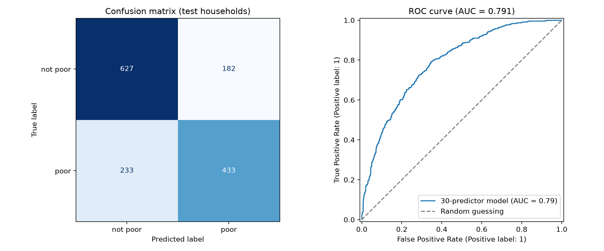

# pmt-Burundi: poverty classification from household data

A proxy means testing tool for Burundi: from a short list of observable household characteristics, a machine learning model estimates whether a household is among the poorest 40%. The project covers the full pipeline (data cleaning, model training), a web service with a demo form, and Docker files to run it anywhere.

## Background

Burundi is one of the poorest countries in the world, and its government faces a constant challenge: how to improve the living conditions of the population. National household data collection helps the government, NGOs and international organizations understand how the population is doing and where help should be focused. However, the traditional methods require large amounts of effort and resources before a household can be classified as poor or not poor. This project therefore uses the household data collected by INSBU in 2023 to build a machine learning proxy tool. Using only observable living conditions, it estimates whether a household is among the poorest 40%, which simplifies the work of the government and its partners.

## Data and method

The data contains 7,824 households and 221 variables. Most of the variables were coded, so the first step was to link them to the translated codebook. Interviews that were not completed were dropped, which left 7,407 households. The variable `m11cons` (number of items consumed by the household) was used to build the label: a household is poor if it consumed 12 items or fewer (`m11cons` <= 12). This cut-off is the 40th percentile of the data. Because many households share the value 12, the rule labels 43.9% of the households as poor.

The data also contains a wealth index (`wlthind5`), but it was not used. It can be rebuilt almost perfectly from the housing and asset variables, so using it would leak information about the label and the model would partly be given the answer. Other steps in this stage were leakage tests (making sure that nothing that reveals the answer enters the pipeline), exclusions (which variables to drop, and why), sanity checks, and a decision log. Predictors were dropped when they were sensitive information (names, dates of birth), mostly empty, or otherwise unsuitable, which left 111 candidate predictors.

The data was split by cluster number (`hh1`), so that no cluster appears in both the training and the test data. A baseline logistic regression was compared with two tree-based models, Random Forest and XGBoost, which suit large tabular data. XGBoost performed best. Finally, the predictors were reduced from 111 to 30 (24 questions) with a rule fixed before the test data was used: the smallest list whose cross-validated scores stay within 0.01 AUC and 0.02 recall of the full model.

## Results

The final model was evaluated once, on 1,475 test households it had never seen. It reaches an AUC of 0.791 and an accuracy of 0.719. It finds 65% of the poor households (recall 0.650), and 70% of the households it flags as poor really are poor (precision 0.704). In numbers, of the 666 poor test households the model finds 433 and misses 233, and of the 809 non-poor households it classifies 627 correctly and wrongly flags 182. The model using all 111 predictors scores only slightly higher (AUC 0.801, recall 0.680), so cutting the questionnaire down to 30 predictors (24 questions) costs about 0.01 in AUC while making the interview much shorter.



## Project structure

```
pmt-Burundi/
├── README.md              this file
├── AI_USE.md              AI use disclosure
├── Dockerfile             builds the image of the web service
├── .dockerignore          keeps data and notebooks out of the image
├── requirements.txt       all libraries (notebooks and pipeline)
├── requirements-api.txt   libraries needed by the web service only
├── src/
│   ├── ingest.py          reads the raw data and the translated codebook
│   ├── preprocess.py      cleaning, following the decision log
│   ├── train.py           split, training, evaluation, saves the model
│   └── make_form.py       builds the demo form questions
├── notebooks/
│   ├── 01_explore_data.ipynb   data exploration, label, leakage tests, decision log
│   └── 02_modelling.ipynb      split, model choice, 30-predictor selection, evaluation
├── models/
│   ├── xgb_model.joblib   the trained model
│   └── model_info.json    predictors, valid ranges, test scores
├── api/
│   ├── main.py            web service (/predict, /health, demo form)
│   ├── form_fields.json   questions of the demo form
│   └── static/index.html  the demo form page
├── docs/
│   ├── decision_log.md    every cleaning and design decision
│   ├── data_dictionary.csv    codes, English names and values of the predictors
│   ├── final_predictors.txt   the 111 candidate predictors
│   ├── short_predictors.csv   the 30 final predictors with their questions
│   ├── short_predictors.txt   the 30 final predictors (codes only)
│   └── figures/evaluation.png
└── data/                  raw and processed data (not included, see below)
```

## Quick start

The trained model is included in the repository, so the web service runs without the raw data.

### Option 1: Docker

```
docker build -t pmt-burundi .
docker run -p 8000:8000 pmt-burundi
```

### Option 2: without Docker (Python 3.12)

```
python -m venv .venv
.venv\Scripts\activate          (Windows)   or   source .venv/bin/activate   (Linux, Mac)
pip install -r requirements-api.txt
python -m uvicorn api.main:app
```

### Using the service

- `http://localhost:8000` : the demo form. Click an example household, or fill in the answers, then press Predict. The result shows the verdict, the risk score and the answers that pushed the score up or down.
- `http://localhost:8000/docs` : the interactive API page (`POST /predict`).
- `http://localhost:8000/health` : service status and the test scores of the model.

The example households are typical profiles built from the test data. No real household is used.

## The data and how to rerun the pipeline

The raw data is not included in this repository. To rerun the pipeline, place these two files in `data/raw/`:

- `hh.csv` (the household data)
- `household codebook file - Translation.xlsx` (the translated codebook)

Then, from the project root and in this order:

```
python src/preprocess.py
python src/train.py
python src/make_form.py
```

`preprocess` writes the clean data to `data/processed/`, `train` saves the model in `models/`, and `make_form` rebuilds the questions of the demo form. The notebooks in `notebooks/` show the reasoning behind each step, with their outputs saved.

## Limitations

- **The model misses about 35% of poor households** (recall 0.65), and about 3 in 10 households it flags as poor are not poor (precision 0.70).
- **The label is a relative proxy.** `m11cons` (number of items consumed) is the consumption summary provided in the data. The codebook does not list which items are counted or the reference period, and the count is per household, not per person. Poor means "12 items or fewer in this data", not an official poverty line. The poverty rate is highest in the smallest households (48.3% for 1 to 3 members versus 40.4% for 8 or more), partly because of this.
- **Location matters.** In the training data 46.1% of rural households are poor versus 19.4% of urban households, and the model uses location as one of its signals. Poor households in urban areas are likely harder to detect: the typical urban poor profile scores below the 50% cut.
- **The risk score is not a calibrated probability.** A household is called poor when the score is 50% or more. This is a decision rule of the model, not a poverty line.
- **Answers are validated one by one, not against each other.** The service refuses impossible values, but it does not detect contradictions between two valid answers.
- Neural networks were not tested.
